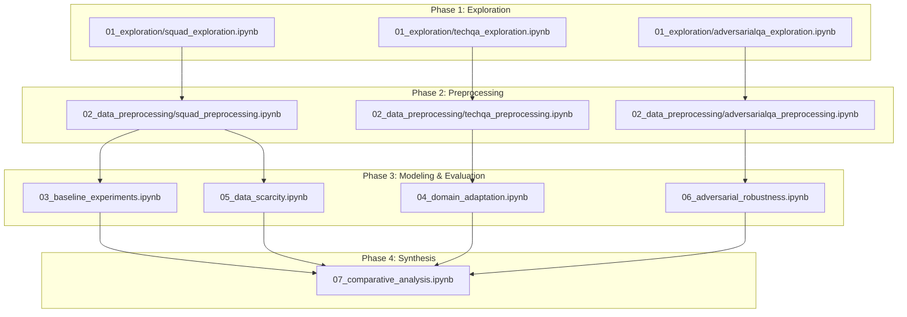

# Notebooks Guide & Workflow Roadmap

This document outlines the sequential research notebook pipeline for the study.

---

## 1. Notebook Pipeline Overview

---

## 2. Directory & Notebook Details

### `notebooks/01_exploration/` (Data Discovery & Quality Checks)
- **`squad_exploration.ipynb`**: Evaluates SQuAD 2.0 distributions, answerable vs. unanswerable ratio, context lengths, and validates character start/end offsets.
- **`techqa_exploration.ipynb`**: Analyzes IBM TechQA training/dev sets, the 800k+ Technotes corpus, domain vocabulary distribution, and Technote length statistics.
- **`adversarialqa_exploration.ipynb`**: Inspects AdversarialQA subsets (`adversarialQA`, `dbert`, `dbidaf`, `droberta`), model-in-the-loop annotations, and test split constraints.

### `notebooks/02_data_preprocessing/` (Tokenization & Span Alignment)
- **`squad_preprocessing.ipynb`**:
  - Creates stratified, reproducible training subsets: 1%, 5%, 10%, and full validation split.
  - Applies sliding-window chunking (`max_length=384`, `doc_stride=128`).
  - Maps character answer spans to token positions using Hugging Face FastTokenizers.
  - Exports tokenized tensors for BERT, RoBERTa, DeBERTa, and DistilBERT into `data/processed/squad2/tokenized/`.
- **`techqa_preprocessing.ipynb`**:
  - Chunks multi-page technical documents into sliding windows with overlap.
  - Formats technical QA pairs and negative instances for training.
- **`adversarialqa_preprocessing.ipynb`**:
  - Aligns adversarial evaluation instances to model tokenizer inputs.

### Experimental Notebooks (Stages 03 – 07)
- **`03_baseline_experiments.ipynb`**: Benchmarks standard general-domain extractive QA fine-tuning across BERT variants on SQuAD 2.0. Evaluates Exact Match (EM) and Macro F1.
- **`04_domain_adaptation.ipynb`**: Runs Domain-Adaptive Pre-Training (DAPT) via Masked Language Modeling (MLM) on the TechQA technotes corpus, followed by downstream evaluation on technical QA.
- **`05_data_scarcity.ipynb`**: Measures performance degradation and sample efficiency across low-resource budgets (1%, 5%, 10%, 100% data) across all candidate architectures.
- **`06_adversarial_robustness.ipynb`**: Tests model resilience against AdversarialQA splits and synthetically perturbed contexts (character typos, distractor sentence insertion, paraphrasing).
- **`07_comparative_analysis.ipynb`**: Aggregates all experiment outputs from `results/metrics/`, conducts statistical significance testing, and generates comparison tables and publication plots.

---

## 3. Working Directory & Path Safety

When running notebooks in Jupyter / VS Code / Cursor:
- The working directory may resolve to the notebook's subfolder (e.g. `notebooks/02_data_preprocessing`).
- Notebooks are configured to dynamically discover `PROJECT_ROOT` so that datasets are always read from `data/raw/` and written to `data/processed/` at the repository root.
