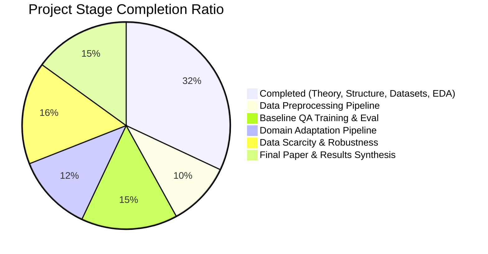

# Project Completion Status & Roadmap Report

**Project Title:** Domain-Adaptive and Robustness-Aware Question Answering: A Comparative Study of Fine-Tuned BERT Variants Under Data-Scarce and Adversarial Conditions  
**Evaluation Date:** November 18, 2026  
**Repository State:** `main` branch (Latest commit: `76845e8 - data exploration done`)  

---

## 1. Executive Summary

| Metric | Status |
| :--- | :--- |
| **Overall Estimated Completion** | **~32%** |
| **Phase 1: Research Design & Documentation** | **100% Completed** |
| **Phase 2: Repository Architecture & Environment** | **100% Completed** |
| **Phase 3: Dataset Ingestion, Audit & EDA** | **70% Completed** (Blocked on TechQA technical corpus) |
| **Phase 4: Preprocessing & Tokenization Pipeline** | **0% Not Started** (Placeholders present) |
| **Phase 5: Baseline QA Modeling & Benchmarking** | **0% Not Started** (Placeholders present) |
| **Phase 6: Domain Adaptation Experiments** | **0% Not Started** (Pending technical dataset) |
| **Phase 7: Data Scarcity Experiments** | **0% Not Started** (Placeholders present) |
| **Phase 8: Adversarial Robustness Evaluation** | **0% Not Started** (Placeholders present) |
| **Phase 9: Results Synthesis & Manuscript** | **20% Drafted** (Literature review & methodology ready) |

---

## 2. Component-by-Component Audit

### 2.1 Research Foundation & Documentation (100% Complete)
- [x] **Literature Review**: [`docs/literature_review.md`](file:///Users/deepika/Desktop/Domain-Adaptive-and-Robustness-Aware-Question-Answering-/docs/literature_review.md) & [`docs/QA_Literature_Review_Verified_with_Research_Gap.pdf`](file:///Users/deepika/Desktop/Domain-Adaptive-and-Robustness-Aware-Question-Answering-/docs/QA_Literature_Review_Verified_with_Research_Gap.pdf) covering extractive QA, domain transfer, data scarcity, and adversarial perturbations.
- [x] **Research Objectives & Questions**: Defined in [`docs/research_objectives.md`](file:///Users/deepika/Desktop/Domain-Adaptive-and-Robustness-Aware-Question-Answering-/docs/research_objectives.md) and [`docs/research_questions.md`](file:///Users/deepika/Desktop/Domain-Adaptive-and-Robustness-Aware-Question-Answering-/docs/research_questions.md).
- [x] **Research Gap & Methodology**: Articulated in [`docs/research_gap.md`](file:///Users/deepika/Desktop/Domain-Adaptive-and-Robustness-Aware-Question-Answering-/docs/research_gap.md) and [`docs/methodology.md`](file:///Users/deepika/Desktop/Domain-Adaptive-and-Robustness-Aware-Question-Answering-/docs/methodology.md).

### 2.2 Environment & Project Structure (100% Complete)
- [x] **Standard Directory Layout**: `configs/`, `data/`, `docs/`, `experiments/`, `notebooks/`, `results/`, `src/`, `tests/`.
- [x] **Configuration Files**: YAML configurations in `configs/` (`dataset_config.yaml`, `experiment_config.yaml`, `model_config.yaml`).
- [x] **Dependencies & Licensing**: Defined in `requirements.txt` and `LICENSE` (MIT).

### 2.3 Dataset Acquisition & Exploratory Data Analysis (EDA) (70% Complete)
- [x] **Download Automation**: `data/download_datasets.py` implemented for automated HF Parquet ingestion.
- [x] **Dataset Audit**: In-depth audit in [`docs/dataset_audit.md`](file:///Users/deepika/Desktop/Domain-Adaptive-and-Robustness-Aware-Question-Answering-/docs/dataset_audit.md) verifying 14 Parquet files (214,192 rows, 29.80 MiB).
- [x] **Exploratory Data Analysis Notebook**: [`notebooks/01_dataset_exploration.ipynb`](file:///Users/deepika/Desktop/Domain-Adaptive-and-Robustness-Aware-Question-Answering-/notebooks/01_dataset_exploration.ipynb) executed with visualizations and statistics.
- [x] **Dataset Analysis Summary**: [`docs/dataset_analysis.md`](file:///Users/deepika/Desktop/Domain-Adaptive-and-Robustness-Aware-Question-Answering-/docs/dataset_analysis.md).
- [ ] **Technical Domain Corpus (BLOCKER)**: IBM TechQA returned HTTP 404 from upstream. A technical dataset replacement (e.g. BioASQ, COVID-QA, PubMedQA, or TechQA archive mirror) is required before domain adaptation can proceed.

### 2.4 Modeling & Experimental Pipelines (0% Complete)
- [ ] **Data Preprocessing & Tokenization**: `src/preprocessing/` and `notebooks/02_data_preprocessing.ipynb` contain skeleton stubs. Needs sliding window tokenization (`stride`), offset mapping for char-to-token span alignment, and handling unanswerable QA pairs.
- [ ] **Baseline Models**: `src/training/`, `src/evaluation/`, `experiments/baseline/`, and `notebooks/03_baseline_experiments.ipynb` are stubs. Models to implement: BERT, RoBERTa, DeBERTa (and optional DistilBERT/ALBERT) on SQuAD 2.0 (EM / F1 metrics).
- [ ] **Domain Adaptation**: `src/domain_adaptation/`, `experiments/domain_adaptation/`, and `notebooks/04_domain_adaptation.ipynb` are stubs. Requires DAPT (Masked Language Modeling on target domain corpus) followed by task fine-tuning.
- [ ] **Data Scarcity Studies**: `src/data_scarcity/`, `experiments/data_scarcity/`, and `notebooks/05_data_scarcity.ipynb` are stubs. Evaluates 100%, 10%, and 1% training splits under controlled random seeds.
- [ ] **Adversarial Robustness Evaluation**: `src/adversarial/`, `experiments/adversarial/`, and `notebooks/06_adversarial_robustness.ipynb` are stubs. Evaluates against AdversarialQA (dbert, dbidaf, droberta splits) and perturbed contexts (distractors, typos, paraphrasing).
- [ ] **Comparative Analysis & Syntheses**: `notebooks/07_comparative_analysis.ipynb` and `results/` are stubs.

---

## 3. Work Breakdown Structure (WBS) & Progress Tracker

| Work Package (WP) | Deliverables | Current Status | % Done |
| :--- | :--- | :--- | :---: |
| **WP1: Research Design** | Literature review, gap analysis, hypotheses, objectives | Completed | 100% |
| **WP2: Data Foundation** | Ingestion script, audit, EDA notebook, visualizations | SQuAD 2.0 & AdversarialQA ready; TechQA blocked | 70% |
| **WP3: Tokenizer & Pipeline** | FastTokenizer alignment, sliding window, negative samples | Notebook 02 & `src/preprocessing/` skeleton | 0% |
| **WP4: Baseline QA** | BERT/RoBERTa/DeBERTa fine-tuning on SQuAD 2.0, EM/F1 eval | Skeletons in `src/training`, `experiments/baseline` | 0% |
| **WP5: Domain Adaptation** | MLM pretraining on technical domain + downstream QA | Pending technical dataset acquisition | 0% |
| **WP6: Scarcity & Robustness**| 100%/10%/1% training subsets, AdversarialQA evaluations | Skeletons in `src/data_scarcity`, `src/adversarial` | 0% |
| **WP7: Synthesis & Writing** | Comparative metrics tables, radar/line plots, final paper | Docs drafted; experimental writeup pending | 20% |

---

## 4. Immediate Critical Path & Next Steps

1. **Resolve Technical Domain Dataset Blocker**:
   - Option A: Identify a mirror or alternative source for IBM TechQA.
   - Option B: Substitute with a validated biomedical or computer science QA dataset (e.g., PubMedQA, BioASQ, or CUAD).
2. **Implement Preprocessing Pipeline (`src/preprocessing/` & `02_data_preprocessing.ipynb`)**:
   - Write Hugging Face `AutoTokenizer` sliding window span extraction logic.
   - Cache preprocessed tensors into `data/processed/`.
3. **Build Baseline Training & Evaluation Engine (`src/training/` & `src/evaluation/`)**:
   - Setup Hugging Face `Trainer` or PyTorch training loops with mixed precision (`fp16`).
   - Implement official SQuAD evaluation script for Exact Match (EM) and Macro F1 scores.
4. **Execute Baseline Experiments (`03_baseline_experiments.ipynb`)**:
   - Benchmark `bert-base-uncased`, `roberta-base`, and `microsoft/deberta-base`.
