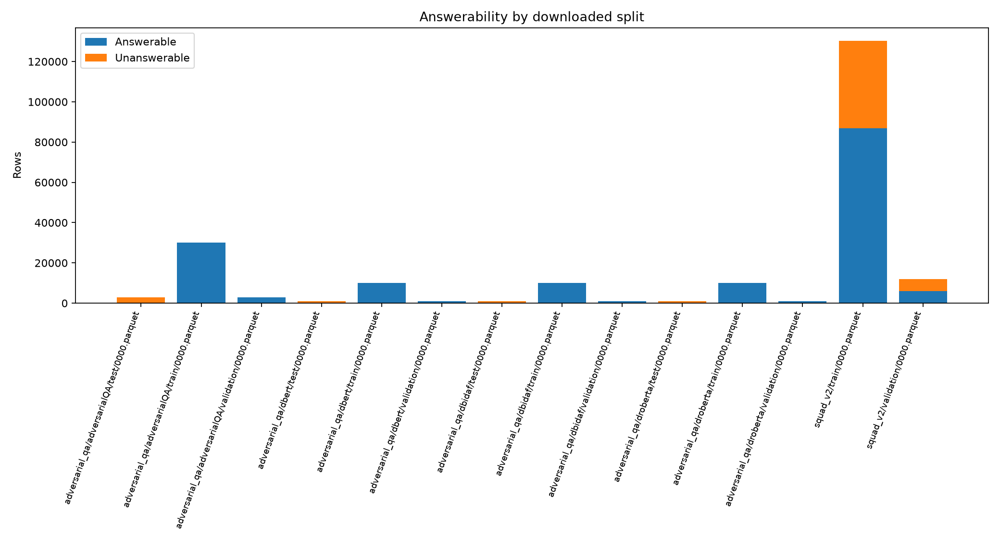
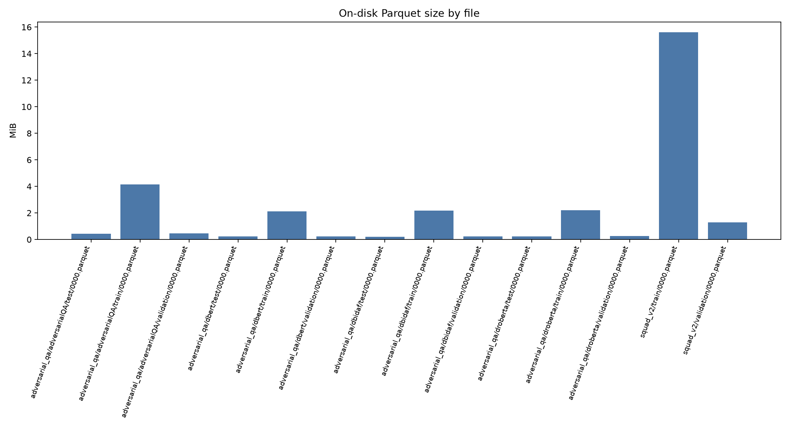

# Dataset audit

**Audit date:** 2026-11-12  
**Method:** Read-only inspection of every `*.parquet` file under `data/raw/` with PyArrow. Original files were not modified. Counts below are verified from the downloaded files; no statistics were inferred from dataset cards.

## Executive summary

- Audited **14 Parquet files** containing **214,192 rows** and **29.80 MiB** on disk.
- All files opened successfully; every file has a nonzero row count.
- All inspected answer spans had valid bounds and exact context matches; no malformed answer structures were found.
- SQuAD 2.0 contains both answerable and unanswerable examples. AdversarialQA train/validation contain answerable examples; every downloaded AdversarialQA test row has empty answer arrays.
- TechQA is not in Parquet form, so it is not part of the 14-file count. It was obtained later (original release files under `data/raw/TechQA/`) and audited separately in the TechQA sections at the end of this document.

## File and split inventory

| Dataset/configuration | Split | Rows | Columns | Disk (MiB) |
|---|---:|---:|---:|---:|
| AdversarialQA / adversarialQA | `test` | 3,000 | 6 | 0.44 |
| AdversarialQA / adversarialQA | `train` | 30,000 | 6 | 4.15 |
| AdversarialQA / adversarialQA | `validation` | 3,000 | 6 | 0.47 |
| AdversarialQA / dbert | `test` | 1,000 | 6 | 0.22 |
| AdversarialQA / dbert | `train` | 10,000 | 6 | 2.12 |
| AdversarialQA / dbert | `validation` | 1,000 | 6 | 0.23 |
| AdversarialQA / dbidaf | `test` | 1,000 | 6 | 0.21 |
| AdversarialQA / dbidaf | `train` | 10,000 | 6 | 2.16 |
| AdversarialQA / dbidaf | `validation` | 1,000 | 6 | 0.22 |
| AdversarialQA / droberta | `test` | 1,000 | 6 | 0.24 |
| AdversarialQA / droberta | `train` | 10,000 | 6 | 2.19 |
| AdversarialQA / droberta | `validation` | 1,000 | 6 | 0.25 |
| SQuAD 2.0 | `train` | 130,319 | 5 | 15.61 |
| SQuAD 2.0 | `validation` | 11,873 | 5 | 1.29 |

## Schemas, types, and missing values

All Parquet files within a dataset/configuration share the same schema. Missing-value counts below are exact null counts; empty strings are reported separately in the quality table.

| Dataset/configuration | Schema (column: Arrow type) | Null fields |
|---|---|---|
| AdversarialQA / adversarialQA | `id` (string), `title` (string), `context` (string), `question` (string), `answers` (struct<text: list<item: string>, answer_start: list<item: int32>>), `metadata` (struct<split: string, model_in_the_loop: string>) | none |
| AdversarialQA / dbert | `id` (string), `title` (string), `context` (string), `question` (string), `answers` (struct<text: list<item: string>, answer_start: list<item: int32>>), `metadata` (struct<split: string, model_in_the_loop: string>) | none |
| AdversarialQA / dbidaf | `id` (string), `title` (string), `context` (string), `question` (string), `answers` (struct<text: list<item: string>, answer_start: list<item: int32>>), `metadata` (struct<split: string, model_in_the_loop: string>) | none |
| AdversarialQA / droberta | `id` (string), `title` (string), `context` (string), `question` (string), `answers` (struct<text: list<item: string>, answer_start: list<item: int32>>), `metadata` (struct<split: string, model_in_the_loop: string>) | none |
| SQuAD 2.0 | `id` (string), `title` (string), `context` (string), `question` (string), `answers` (struct<text: list<item: string>, answer_start: list<item: int32>>) | none |

## Answerability and annotation quality

| File | Answerable | Unanswerable | Answer objects | Malformed lists | Bad bounds | Text/offset mismatches | Empty questions | Empty contexts |
|---|---:|---:|---:|---:|---:|---:|---:|---:|
| `data/raw/adversarial_qa/adversarialQA/test/0000.parquet` | 0 | 3,000 | 0 | 0 | 0 | 0 | 0 | 0 |
| `data/raw/adversarial_qa/adversarialQA/train/0000.parquet` | 30,000 | 0 | 30,000 | 0 | 0 | 0 | 0 | 0 |
| `data/raw/adversarial_qa/adversarialQA/validation/0000.parquet` | 3,000 | 0 | 3,000 | 0 | 0 | 0 | 0 | 0 |
| `data/raw/adversarial_qa/dbert/test/0000.parquet` | 0 | 1,000 | 0 | 0 | 0 | 0 | 0 | 0 |
| `data/raw/adversarial_qa/dbert/train/0000.parquet` | 10,000 | 0 | 10,000 | 0 | 0 | 0 | 0 | 0 |
| `data/raw/adversarial_qa/dbert/validation/0000.parquet` | 1,000 | 0 | 1,000 | 0 | 0 | 0 | 0 | 0 |
| `data/raw/adversarial_qa/dbidaf/test/0000.parquet` | 0 | 1,000 | 0 | 0 | 0 | 0 | 0 | 0 |
| `data/raw/adversarial_qa/dbidaf/train/0000.parquet` | 10,000 | 0 | 10,000 | 0 | 0 | 0 | 0 | 0 |
| `data/raw/adversarial_qa/dbidaf/validation/0000.parquet` | 1,000 | 0 | 1,000 | 0 | 0 | 0 | 0 | 0 |
| `data/raw/adversarial_qa/droberta/test/0000.parquet` | 0 | 1,000 | 0 | 0 | 0 | 0 | 0 | 0 |
| `data/raw/adversarial_qa/droberta/train/0000.parquet` | 10,000 | 0 | 10,000 | 0 | 0 | 0 | 0 | 0 |
| `data/raw/adversarial_qa/droberta/validation/0000.parquet` | 1,000 | 0 | 1,000 | 0 | 0 | 0 | 0 | 0 |
| `data/raw/squad_v2/train/0000.parquet` | 86,821 | 43,498 | 86,821 | 0 | 0 | 0 | 0 | 0 |
| `data/raw/squad_v2/validation/0000.parquet` | 5,928 | 5,945 | 20,302 | 0 | 0 | 0 | 0 | 0 |

### Verified distributions

- **SQuAD 2.0:** train 86,821 answerable / 43,498 unanswerable; validation 5,928 / 5,945.
- **AdversarialQA `adversarialQA`:** train 30,000 answerable, validation 3,000 answerable, test 3,000 unanswerable-by-empty-answer-array.
- **AdversarialQA `dbert`, `dbidaf`, `droberta`:** each has train 10,000 answerable, validation 1,000 answerable, and test 1,000 with empty answer arrays.
- For AdversarialQA, “unanswerable” here means `answers.text` is empty in the downloaded record; it is not evidence that the question is semantically unanswerable. The test files provide no gold span for exact-match/F1 scoring.

## Duplicate analysis

Duplicate counts are computed within each file as `rows - number of unique values`; these are not automatically errors because repeated questions or contexts can be legitimate.

| File | Duplicate question rows | Unique questions | Duplicate context rows | Unique contexts | Duplicate IDs |
|---|---:|---:|---:|---:|---:|
| `data/raw/adversarial_qa/adversarialQA/test/0000.parquet` | 27 | 2,973 | 2,591 | 409 | 0 |
| `data/raw/adversarial_qa/adversarialQA/train/0000.parquet` | 648 | 29,352 | 27,352 | 2,648 | 35 |
| `data/raw/adversarial_qa/adversarialQA/validation/0000.parquet` | 8 | 2,992 | 2,584 | 416 | 0 |
| `data/raw/adversarial_qa/dbert/test/0000.parquet` | 4 | 996 | 708 | 292 | 0 |
| `data/raw/adversarial_qa/dbert/train/0000.parquet` | 133 | 9,867 | 7,556 | 2,444 | 0 |
| `data/raw/adversarial_qa/dbert/validation/0000.parquet` | 0 | 1,000 | 717 | 283 | 0 |
| `data/raw/adversarial_qa/dbidaf/test/0000.parquet` | 2 | 998 | 723 | 277 | 0 |
| `data/raw/adversarial_qa/dbidaf/train/0000.parquet` | 61 | 9,939 | 7,477 | 2,523 | 0 |
| `data/raw/adversarial_qa/dbidaf/validation/0000.parquet` | 0 | 1,000 | 722 | 278 | 0 |
| `data/raw/adversarial_qa/droberta/test/0000.parquet` | 6 | 994 | 667 | 333 | 0 |
| `data/raw/adversarial_qa/droberta/train/0000.parquet` | 261 | 9,739 | 7,448 | 2,552 | 0 |
| `data/raw/adversarial_qa/droberta/validation/0000.parquet` | 4 | 996 | 659 | 341 | 0 |
| `data/raw/squad_v2/train/0000.parquet` | 102 | 130,217 | 111,290 | 19,029 | 0 |
| `data/raw/squad_v2/validation/0000.parquet` | 9 | 11,864 | 10,669 | 1,204 | 0 |

Across all downloaded files, **35,240 distinct question strings** occur in more than one file and **3,473 distinct context strings** occur in more than one file. This is expected for AdversarialQA configurations that derive from related source material; it means configurations must not be pooled and treated as independent examples without deduplication analysis.

## Dataset-format compatibility

| Dataset | Extractive QA suitability | Limitation affecting validity |
|---|---|---|
| SQuAD 2.0 | Suitable for supervised extractive QA and no-answer handling. | General-domain rather than technical-domain; only train/validation are available in these files. |
| AdversarialQA train/validation | Structurally suitable for extractive QA: context, question, answer text and character start are present. | Model-specific configurations and cross-configuration overlap complicate independent-comparison claims. |
| AdversarialQA test | Suitable for prediction-only/qualitative robustness checks. | Empty answer arrays in every downloaded test record prevent standard gold-span EM/F1 evaluation. |
| TechQA | Suitable for extractive QA with no-answer handling: answers are character offsets into one of the candidate Technotes. | Only 600 train / 310 dev questions; long answers (median about 250 characters); long documents need chunking; 11 of 160 answerable dev spans do not exactly match their stored text; blind test set not public. |

## Visualizations

## Inconsistencies with `docs/dataset_analysis.md`

- The previously documented row counts, schemas, disk-size approximations, and zero malformed/bad-span findings agree with this audit.
- The prior analysis described AdversarialQA test rows as “unanswerable/no-gold-answer”; this audit confirms the exact observable condition is empty answer arrays, not a semantic unanswerability label.
- The prior analysis says “all four available configurations”; the actual configuration names verified on disk are `adversarialQA`, `dbert`, `dbidaf`, and `droberta`. There is no configuration literally named `bert`; `dbidaf` is the available BiDAF configuration.
- `docs/dataset_analysis.md` originally reported TechQA as unavailable (HTTP 404). It has since been obtained and audited; both documents were updated on 2026-11-26.

## Recommendations

1. Do not report AdversarialQA test EM/F1 unless an authorized answer key is obtained; use train/validation for scored robustness evaluation or explicitly label test results prediction-only.
2. Keep AdversarialQA configurations separate in experiments and report overlap/deduplication policy.
3. Resolve the 11 mismatched TechQA dev answer spans during preprocessing, without modifying the original annotations, and exclude dev Technotes from any domain-adaptive pretraining text.
4. Preserve these Parquet files as raw inputs and perform any normalization only into `data/processed/`.
FOR TECHQA DATASET DETAILS 
### TechQA Development Answer Alignment Validation

**Total development questions:** 310  
**Answerable questions checked:** 160

| Validation metric | Result |
|---|---:|
| Missing documents | 0 |
| Missing candidate document IDs | 0 |
| Invalid offsets | 0 |
| Exact answer mismatches | 11 |
| Whitespace-only differences | 2 |
| Content differences | 9 |

**Conclusion:**

All 160 answerable development questions reference existing supporting documents and have valid character-offset boundaries. However, 11 answer spans do not exactly match their stored answers.

Two cases are whitespace-related, while nine show content or formatting differences.

These cases require further investigation before finalising the development preprocessing strategy. Original dataset annotations will remain unchanged.
### TechQA Corpus Analysis

**Corpus:** `full_technote_collection.txt.bz2`

#### Corpus Statistics

- **Total documents:** 801,998
- **Empty documents:** 2
- **Duplicate document IDs:** 0
- **Missing document IDs:** 0
- **Documents under 100 characters:** 40
- **Documents over 50,000 characters:** 1,191
- **Minimum text length:** 7 characters
- **Maximum text length:** 903,483 characters
- **Average text length:** 3,198.41 characters
- **Median text length:** 2,361 characters

#### Key Findings

- The corpus contains 801,998 technical documents.
- All documents have unique identifiers, with no missing or duplicate IDs.
- Only 2 documents contain empty text.
- A small number of documents are unusually short or long.
- The corpus contains IBM technical support information, including error descriptions, product issues, and troubleshooting content.
- Long documents will require appropriate chunking during preprocessing to handle model input-length limitations.

#### Conclusion

The TechQA technical document corpus passed the initial integrity and quality checks. It is a promising resource for Domain-Adaptive Pretraining (DAPT), subject to further text cleaning and preprocessing.

**Validation note:** This analysis covers the full 801,998-document corpus. The separate 50,000-document statistics are not included because they have not been reconciled with this full-corpus analysis.
## SQuAD 2.0 Dataset Audit

### 1. Dataset Overview

SQuAD 2.0 (Stanford Question Answering Dataset) contains answerable and unanswerable questions based on provided text passages.

**Dataset location:** `data/raw/squad_v2/`

**Files inspected:**
- `train/0000.parquet`
- `validation/0000.parquet`

### 2. Dataset Structure

The dataset contains five columns:

| Column | Description |
|---|---|
| `id` | Unique question identifier |
| `title` | Article title |
| `context` | Passage containing relevant information |
| `question` | Question based on the passage |
| `answers` | Answer text and character start position |

### 3. Dataset Statistics

| Metric | Training | Validation |
|---|---:|---:|
| Total questions | 130,319 | 11,873 |
| Answerable | 86,821 | 5,928 |
| Unanswerable | 43,498 | 5,945 |
| Answerable (%) | 66.62% | 49.93% |
| Unanswerable (%) | 33.38% | 50.07% |
| Average question length | 9.89 words | 10.02 words |
| Average context length | 119.61 words | 127.91 words |
| Average answer length | 3.16 words | 3.06 words |
| Duplicate question IDs | 0 | 0 |

### 4. Validation Results

| Validation check | Training | Validation |
|---|---:|---:|
| Missing values | 0 | 0 |
| Invalid answer texts | 0 | 0 |
| Invalid character offsets | 0 | 0 |

All checked answer texts and character positions matched their corresponding contexts.

### 5. Key Findings

- Both training and validation splits contain answerable and unanswerable questions.
- Training has a higher proportion of answerable questions.
- Validation has an almost equal distribution of answerable and unanswerable questions.
- No duplicate question IDs were detected.
- All checked answer spans and offsets passed validation.

### 6. Conclusion

The SQuAD 2.0 dataset passed the initial structural inspection, statistical analysis and answer-span validation checks. It is suitable to proceed to the next stage of preprocessing, subject to the project's preprocessing and quality-control requirements.