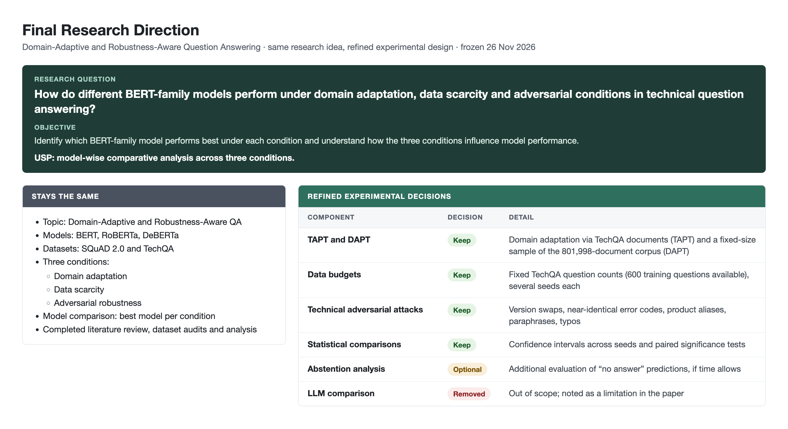

# Final Research Direction (frozen)

**Status:** frozen on 26 November 2026. Change this only by a deliberate team decision, and record the change at the bottom of this file.

This is the same research idea as before. Only some experimental choices from the literature-review PDF (`QA_Literature_Review_Verified_with_Research_Gap.pdf`) have been refined. The completed literature review, dataset audits and analysis remain valid.

## Research question

**How do different BERT-family models perform under domain adaptation, data scarcity and adversarial conditions in technical question answering?**

## Objective

Identify which BERT-family model performs best under each condition and understand how the three conditions influence model performance.

## USP

**Model-wise comparative analysis across three conditions.**

## What stays the same

- **Topic:** Domain-Adaptive and Robustness-Aware Question Answering.
- **Models:** BERT, RoBERTa and DeBERTa.
- **Datasets:** SQuAD 2.0 and TechQA.
- **Three conditions:**
  1. Domain adaptation.
  2. Data scarcity.
  3. Adversarial robustness.
- **Comparison:** compare model performance and identify which model works best under each condition.

## Refined experimental decisions

| Component | Decision | Detail |
|---|---|---|
| TAPT and DAPT | **Keep** | Domain adaptation through TechQA documents (TAPT) and a fixed-size sample of the 801,998-document Technote corpus (DAPT). |
| Data budgets | **Keep** | Fixed TechQA question counts (600 training questions available), several seeds for each. |
| Technical adversarial attacks | **Keep** | Version swaps, near-identical error codes, product aliases, paraphrases and typos. |
| Statistical comparisons | **Keep** | Confidence intervals across seeds and paired significance tests. |
| Abstention analysis | **Optional** | Additional evaluation of "no answer" predictions, if time allows. |
| LLM comparison | **Removed** | Out of scope; noted as a limitation in the paper. |

## Open point to confirm

AdversarialQA was downloaded and audited (`docs/dataset_audit.md`), but it is not in the frozen dataset list. The adversarial condition is now built on technical attacks applied to TechQA. The team should decide whether AdversarialQA is:

- kept as a secondary, general-domain robustness reference, or
- dropped from the experiments (and its audit kept only as background work).

Until that is decided, do not build experiment code that depends on AdversarialQA.

## How the other docs relate to this one

`research_questions.md`, `research_objectives.md` and `methodology.md` contain the detailed sub-questions, controls and procedures. Where they disagree with this file, this file wins.

## Change log

- 2026-11-26: Direction frozen. LLM comparison removed; abstention analysis made optional; TAPT/DAPT, data budgets, technical adversarial attacks and statistical comparisons kept.
